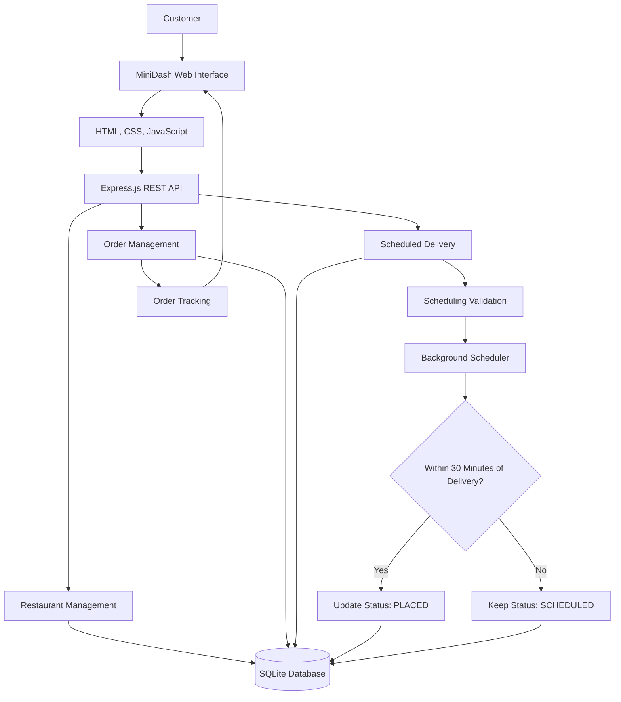

# 🍔 MiniDash — Food Delivery Application

MiniDash is a full-stack food delivery application built with Node.js, Express, SQLite, HTML, CSS, and JavaScript.

The application allows customers to browse restaurants, view menus, add items to a shopping cart, place orders, schedule future deliveries, and track their order status.

MiniDash includes a RESTful API and a responsive web interface.

## 🚀 Features

### Restaurant Browsing
- View available restaurants.
- Browse restaurant menus.
- View menu item names and prices.
- Check restaurant operating hours.

### Shopping Cart
- Add menu items to a cart.
- Increase or decrease item quantities.
- View order totals.
- Place orders from one restaurant at a time.

### Order Management
- Place immediate delivery orders.
- Retrieve existing orders.
- Track order status.
- View order details, including items, prices, and delivery addresses.

### 📅 Scheduled Delivery
- Choose between immediate and scheduled delivery.
- Schedule orders between 45 minutes and 7 days in advance.
- Validate delivery times against restaurant opening hours.
- Require timezone-aware timestamps.
- Store scheduled delivery information in the database.
- Automatically check for scheduled orders ready for release.
- Transition eligible scheduled orders from `SCHEDULED` to `PLACED` at the 30-minute release threshold.
- Allow customers to cancel scheduled orders before release.
- Prevent duplicate order releases through conditional database updates.

### Order Tracking
- View the current order status.
- Display delivery progress for active orders.
- Refresh order status.
- View restaurant names, delivery addresses, and order totals.
- Cancel eligible scheduled orders through the interface.

## 🛠️ Technologies Used

| Technology | Purpose |
|---|---|
| Node.js | JavaScript runtime |
| Express.js | REST API and web server |
| SQLite | Database |
| HTML5 | User interface structure |
| CSS3 | User interface styling |
| JavaScript | Frontend functionality |
| REST Client | API endpoint testing |
| Node.js Test Runner | Automated testing |
| Git and GitHub | Version control |

## 📁 Project Structure

```text
MiniDash/
├── public/
│   ├── index.html
│   ├── script.js
│   └── style.css
├── server.js
├── database.js
├── scheduling.js
├── scheduling.test.js
├── clock.js
├── requests.http
├── package.json
├── package-lock.json
├── README.md
└── .gitignore
```

*File names may vary depending on the local project configuration.*

## ⚙️ Installation

### Windows PowerShell

If PowerShell blocks npm commands, use:

npm.cmd install
npm.cmd run init-db
npm.cmd start
npm.cmd test

### 1. Clone the Repository

Clone the MiniDash repository from GitHub and open the project folder.

### 2. Install Dependencies

```bash
npm install
```

### 3. Initialize the Database

```bash
npm run init-db
```

### 4. Start the Server

```bash
npm start
```

By default, MiniDash runs on port `3000`.

### 5. Open the Application

Open the following address in your browser:

`http://localhost:3000/`

The restaurant API is available at:

`http://localhost:3000/restaurants`

## 🔗 REST API Endpoints

| Method | Endpoint | Description |
|---|---|---|
| GET | `/restaurants` | Retrieve available restaurants |
| GET | `/restaurants/:id/menu` | Retrieve a restaurant's menu |
| POST | `/orders` | Create an immediate or scheduled order |
| GET | `/orders/:id` | Retrieve order information |
| PATCH | `/orders/:id/status` | Update an order's status |
| POST | `/orders/:id/cancel` | Cancel an eligible scheduled order |

## 📦 Example: Create an Immediate Order

**POST `/orders`**

```json
{
  "restaurant_id": 1,
  "items": [
    {
      "menu_item_id": 1,
      "quantity": 2
    }
  ],
  "delivery_address": "123 Main Street, Bronx, NY"
}
```

## 📅 Example: Create a Scheduled Order

**POST `/orders`**

```json
{
  "restaurant_id": 1,
  "items": [
    {
      "menu_item_id": 1,
      "quantity": 2
    }
  ],
  "delivery_address": "123 Main Street, Bronx, NY",
  "scheduled_delivery_time": "2026-10-31T18:00:00-04:00"
}
```

The timestamp must include an explicit timezone offset or `Z`.

Scheduled delivery times must be at least 45 minutes and no more than 7 days in the future.

The restaurant must be open at the requested delivery time.

## 🔄 Scheduled Order Lifecycle

Scheduled orders follow this process:

1. The customer selects a future delivery time.
2. The backend validates the requested time.
3. The order is created with status `SCHEDULED`.
4. The server periodically checks for orders eligible for release.
5. When the delivery time is within 30 minutes, the order becomes eligible to transition to `PLACED`.
6. The customer may cancel the order while it remains `SCHEDULED`.
7. Once the order is released, scheduled-order cancellation is no longer available.

The release operation uses a conditional database update to prevent the same order from being released more than once.

## 🧪 Automated Testing

MiniDash uses the built-in Node.js test runner.

Run tests using:

```bash
npm test
```

### Current Automated Test Coverage

| Test | Result |
|---|---|
| 45-minute minimum scheduling | Passed |
| 7-day maximum scheduling | Passed |
| Restaurant opening-hours validation | Passed |
| Explicit timezone validation | Passed |
| Order remains scheduled before release | Passed |
| Order releases at the 30-minute threshold | Passed |
| Order is released only once | Passed |

**Latest test results:**

```text
Tests: 7
Passed: 7
Failed: 0
```

The automatic-release tests use a simulated database. Additional integration testing is recommended to verify the real SQLite database and background scheduler.

## 🔒 Configuration and Security

The `.gitignore` file should exclude local dependencies, database files, and environment secrets.

Example:

```gitignore
node_modules/
.env
*.db
*.db-journal
*.db-shm
*.db-wal
```

## 🔮 Future Improvements

Potential future enhancements include:

- Customer accounts and authentication.
- Restaurant administration dashboard.
- Payment processing.
- Email or SMS order notifications.
- Live delivery tracking.
- Additional automated integration tests.
- Improved mobile responsiveness.

## 📌 Project Status

MiniDash currently supports restaurant browsing, menu viewing, shopping cart management, immediate ordering, scheduled deliveries, order tracking, and cancellation of eligible scheduled orders.

The project includes seven passing automated tests and a functional web interface.

## 🏗️ System Architecture

The following diagram illustrates how MiniDash components communicate.



## 📄 License

This project was developed for educational purposes.